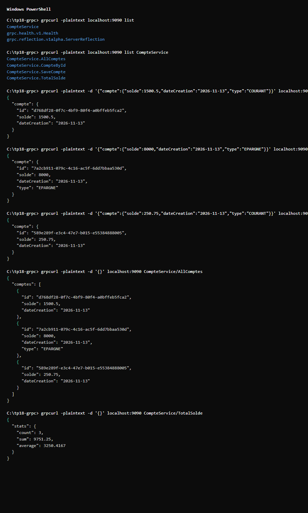

# TP18 — Implémentation d'un Service gRPC avec Spring Boot

Ce projet correspond au **TP18** du module : implémentation d'un service **gRPC** avec **Spring Boot** pour la gestion de comptes bancaires.

L'application expose un service gRPC `CompteService` qui permet de :

- lister tous les comptes (`AllComptes`)
- récupérer un compte par son identifiant (`CompteById`)
- calculer les statistiques de solde (`TotalSolde`)
- créer / mettre à jour un compte (`SaveCompte`)

Les données sont persistées dans une base **H2 en mémoire** via **Spring Data JPA**.

---

## Architecture

Le projet suit une architecture en couches :

```
grpcurl (client) ── gRPC ──▶ CompteServiceImpl (controller)
                                   │
                                   ▼
                            CompteService (service)
                                   │
                                   ▼
                           CompteRepository (JPA)
                                   │
                                   ▼
                          Compte (entité) ──▶ H2 (in-memory)
```

| Élément | Rôle |
|---------|------|
| [CompteService.proto](src/main/proto/CompteService.proto) | Contrat gRPC (messages + service) en Protobuf |
| [CompteServiceImpl](src/main/java/ma/projet/grpc/controllers/CompteServiceImpl.java) | Implémentation des RPC (`@GrpcService`) |
| [CompteService](src/main/java/ma/projet/grpc/services/CompteService.java) | Couche métier |
| [CompteRepository](src/main/java/ma/projet/grpc/repositories/CompteRepository.java) | Accès aux données (Spring Data JPA) |
| [Compte](src/main/java/ma/projet/grpc/entities/Compte.java) | Entité JPA |
| [application.properties](src/main/resources/application.properties) | Configuration (port gRPC, H2) |

---

## Prérequis

- **JDK 21**
- **Maven 3.9+**
- **grpcurl** (pour tester le service)

Sous Windows, penser à configurer `JAVA_HOME` sur le JDK 21 :

```powershell
$env:JAVA_HOME = "C:\Program Files\Java\jdk-21"
$env:PATH = "$env:JAVA_HOME\bin;$env:PATH"
```

---

## Compilation

```powershell
mvn clean package -DskipTests
```

Le plugin `protobuf-maven-plugin` génère automatiquement les stubs Java à partir de `CompteService.proto` dans `target/generated-sources/protobuf/`.

---

## Lancement du serveur

```powershell
mvn spring-boot:run
```

Le serveur démarre sur deux ports :

- **gRPC** : `9090`
- **HTTP (Tomcat)** : `8080`

---

## Test du service avec grpcurl

La réflexion gRPC est activée, ce qui permet à `grpcurl` de découvrir les services sans fournir le fichier `.proto`.

### 1. Lister les services

```powershell
grpcurl -plaintext localhost:9090 list
```

```
CompteService
grpc.health.v1.Health
grpc.reflection.v1alpha.ServerReflection
```

### 2. Lister les méthodes du service

```powershell
grpcurl -plaintext localhost:9090 list CompteService
```

```
CompteService.AllComptes
CompteService.CompteById
CompteService.SaveCompte
CompteService.TotalSolde
```

### 3. Créer des comptes (`SaveCompte`)

```powershell
grpcurl -plaintext -d '{"compte":{"solde":1500.5,"dateCreation":"2026-11-13","type":"COURANT"}}' localhost:9090 CompteService/SaveCompte
grpcurl -plaintext -d '{"compte":{"solde":8000,"dateCreation":"2026-11-13","type":"EPARGNE"}}' localhost:9090 CompteService/SaveCompte
grpcurl -plaintext -d '{"compte":{"solde":250.75,"dateCreation":"2026-11-13","type":"COURANT"}}' localhost:9090 CompteService/SaveCompte
```

> Sous PowerShell, les guillemets internes du JSON sont supprimés par la ligne de commande.
> Utiliser `cmd /c "..."` avec échappement `\"`, ou exécuter les commandes depuis un script `.ps1`.

### 4. Lister tous les comptes (`AllComptes`)

```powershell
grpcurl -plaintext -d '{}' localhost:9090 CompteService/AllComptes
```

### 5. Statistiques de solde (`TotalSolde`)

```powershell
grpcurl -plaintext -d '{}' localhost:9090 CompteService/TotalSolde
```

### 6. Récupérer un compte par ID (`CompteById`)

```powershell
grpcurl -plaintext -d '{"id":"<ID_DU_COMPTE>"}' localhost:9090 CompteService/CompteById
```

---

## Résultats réels et interprétations

### 1. Création et lecture des comptes



**Interprétation :**

- Les trois appels `SaveCompte` renvoient chacun un compte avec un **identifiant UUID généré automatiquement** (`d768df28-...`, `7a2cb911-...`, `589e289f-...`). La persistance fonctionne.
- Le champ `type` est omis dans la réponse JSON quand sa valeur est `COURANT` (valeur par défaut de l'énumération proto3, indice `0`). C'est un comportement normal de Protobuf : les valeurs par défaut ne sont pas sérialisées. On le voit bien avec le compte `EPARGNE` (indice `1`) qui, lui, apparaît dans le JSON.
- `AllComptes` renvoie la liste complète des **3 comptes** créés : la base H2 contient bien les données.
- `TotalSolde` renvoie `count=3`, `sum=9751.25` et `average=3250.4167` :
  - somme : `1500.5 + 8000 + 250.75 = 9751.25` ✅
  - moyenne : `9751.25 / 3 = 3250.4167` ✅

### 2. Lecture par ID et gestion d'erreur


**Interprétation :**

- `CompteById` avec un ID existant renvoie le compte `EPARGNE` avec son solde `8000`.
- `CompteById` avec un ID inexistant (`00000000-...`) renvoie une **erreur gRPC `NOT_FOUND`** avec le message `Compte non trouvé : ...`. Le service ne renvoie plus d'exception vide : l'erreur est proprement typée avec un code et une description.

### 3. Persistance vérifiée dans la console H2


**Interprétation :**

- La requête `SELECT * FROM COMPTE` dans la console H2 (accessible sur `http://localhost:8080/h2-console`) montre les **3 lignes** réellement persistées par les appels `SaveCompte`.
- Chaque ligne contient l'ID UUID, le solde, la date de création et le type (`COURANT` / `EPARGNE`) : la couche JPA écrit bien en base, et la couche gRPC lit bien depuis cette même base.

---

## Notes techniques (écarts avec le texte du TP)

Deux ajustements ont été nécessaires par rapport au `pom.xml` proposé dans l'énoncé :

1. **Alignement des versions gRPC / Protobuf** : le starter `net.devh:grpc-server-spring-boot-starter:3.1.0.RELEASE` exige gRPC `1.63.0` et Protobuf `3.25.3` (l'énoncé listait `1.53.0` / `3.22.0`, incompatibles avec ce starter).
2. **Ajout du plugin `protobuf-maven-plugin`** : l'énoncé omet ce plugin ; sans lui, aucun stub gRPC n'est généré. Il a été ajouté avec les goals `compile` et `compile-custom`.
3. **Ajout de `javax.annotation-api`** : sur JDK 9+, les stubs générés importent `javax.annotation.Generated`, absent du JDK. La dépendance `javax.annotation:javax.annotation-api:1.3.2` règle la compilation.
4. **Correction de la génération d'ID** : l'énoncé utilise `@GeneratedValue(strategy = GenerationType.AUTO)` avec un ID de type `String`. Hibernate 6 lève l'erreur `Unknown integral data type for ids : java.lang.String`. La stratégie a été remplacée par `GenerationType.UUID`.
5. **Amélioration de la gestion d'erreur** : `CompteById` renvoie désormais `Status.NOT_FOUND.withDescription(...)` au lieu d'un `new Throwable()` vide.
