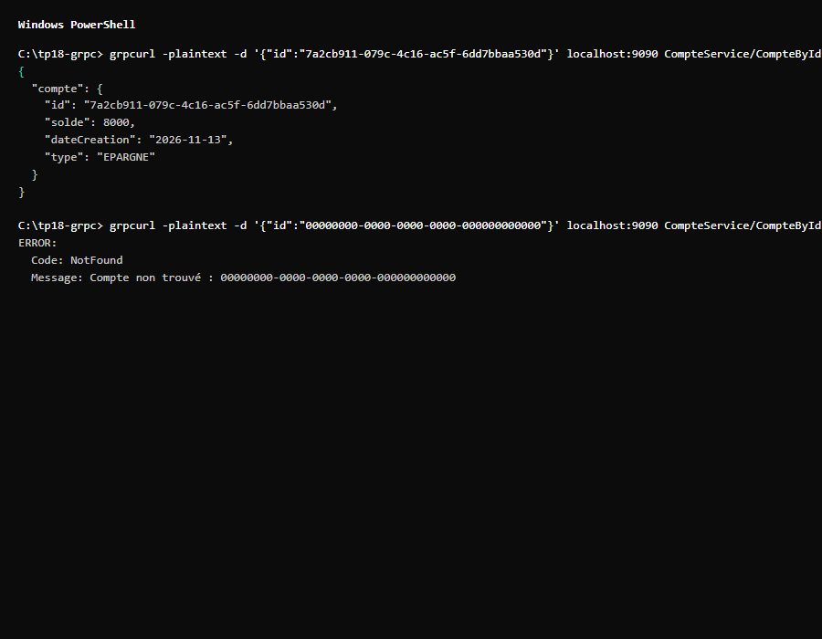
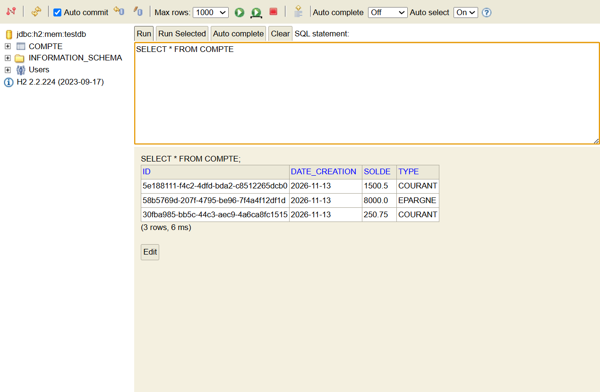

# TP18 — Implémentation d'un Service gRPC avec Spring Boot

## Résultats réels et interprétations

### 1. Création et lecture des comptes

**Interprétation :**

- Les trois appels `SaveCompte` renvoient chacun un compte avec un **identifiant UUID généré automatiquement** (`d768df28-...`, `7a2cb911-...`, `589e289f-...`). La persistance fonctionne.
- Le champ `type` est omis dans la réponse JSON quand sa valeur est `COURANT` (valeur par défaut de l'énumération proto3, indice `0`). C'est un comportement normal de Protobuf : les valeurs par défaut ne sont pas sérialisées. On le voit bien avec le compte `EPARGNE` (indice `1`) qui, lui, apparaît dans le JSON.
- `AllComptes` renvoie la liste complète des **3 comptes** créés : la base H2 contient bien les données.
- `TotalSolde` renvoie `count=3`, `sum=9751.25` et `average=3250.4167` :
  - somme : `1500.5 + 8000 + 250.75 = 9751.25` 
  - moyenne : `9751.25 / 3 = 3250.4167` 

### 2. Lecture par ID et gestion d'erreur

**Interprétation :**

- `CompteById` avec un ID existant renvoie le compte `EPARGNE` avec son solde `8000`.
- `CompteById` avec un ID inexistant (`00000000-...`) renvoie une **erreur gRPC `NOT_FOUND`** avec le message `Compte non trouvé : ...`. Le service ne renvoie plus d'exception vide : l'erreur est proprement typée avec un code et une description.

### 3. Persistance vérifiée dans la console H2

**Interprétation :**

- La requête `SELECT * FROM COMPTE` dans la console H2 (accessible sur `http://localhost:8080/h2-console`) montre les **3 lignes** réellement persistées par les appels `SaveCompte`.
- Chaque ligne contient l'ID UUID, le solde, la date de création et le type (`COURANT` / `EPARGNE`) : la couche JPA écrit bien en base, et la couche gRPC lit bien depuis cette même base.

---

